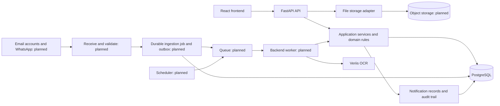

# Recruitment CRM architecture

This design follows the 12-page [Recruitment CRM — Developer Specification](requirements/recruitment-crm-developer-specification.pdf), dated 14 October 2026. Page references below refer to that PDF. The repository assessment is dated 19 October 2026.

The project already contains a working foundation: a React application, a FastAPI API, PostgreSQL models and migrations, candidate entry with OCR, matching, stage processing, and several connected CRM screens. It is **not a complete implementation of the PRD**. This document separates the organization established in Phase 0 from the runtime behavior still to build. The [requirements matrix](requirements-matrix.md) records individual gaps; the [implementation phases](implementation-phases.md) define delivery order and acceptance criteria.

The user's earlier `email-automation-main` and `gmail automation` CRMs were also reviewed at source level. The [reference comparison](reference-architecture-review.md) records useful intake/OCR/storage/recovery patterns and the business rules that differ. PostgreSQL, the existing frontend stack and this PRD remain authoritative; no reference applications or live data were migrated.

## 1. Architecture decision

Keep a **modular monolith**: one frontend, one backend codebase, one PostgreSQL database, and explicit business modules. Add separately runnable worker and scheduler processes from that same backend when automation is implemented. This retains the existing stack and avoids splitting candidate, application, task, and audit transactions across services.

The CRM database is the candidate database. There is no second candidate system to synchronize (PRD p. 6). A candidate is a reusable person record; an application is that candidate's history on a particular order. A task is a unit of work generated by the system, while a to-do is a private manually managed item.



**Present today:** the frontend, API, PostgreSQL models/migrations, request-driven OCR integration, local file storage and partial notification/audit data structures. **Planned:** provider connections, automatic ingestion, object storage, durable queue, workers, scheduler, and complete notification/audit workflows. A database table alone does not establish an implemented service.

## 2. Repository organization established in Phase 0

```text
crm/
├── frontend/
│   ├── package.json                # Browser dependencies and frontend scripts
│   ├── index.html
│   ├── vite.config.ts
│   ├── tsconfig.json
│   ├── tailwind.config.js
│   ├── postcss.config.js
│   ├── public/                     # Browser assets
│   └── src/
│       ├── main.tsx
│       ├── app/
│       │   ├── App.tsx
│       │   ├── routes.tsx
│       │   ├── providers/
│       │   ├── layout/
│       │   └── config/
│       ├── features/
│       │   ├── auth/
│       │   ├── dashboard/
│       │   ├── inbox/
│       │   ├── clients/
│       │   ├── companies/           # Existing extension; see PRD reconciliation
│       │   ├── jobs/
│       │   ├── candidates/
│       │   ├── workflow/
│       │   ├── tasks/
│       │   ├── todos/
│       │   ├── reports/
│       │   └── users/
│       ├── shared/
│       │   ├── api/
│       │   ├── lib/
│       │   ├── model/
│       │   ├── state/
│       │   ├── ui/
│       │   ├── components/
│       │   └── workflow/
│       ├── styles/
│       └── mocks/                  # Historical fixture data; not live CRM data
├── backend/
│   ├── app/
│   │   ├── main.py                 # HTTP application composition
│   │   ├── cli.py
│   │   ├── api/
│   │   │   ├── schemas.py          # Existing HTTP response schemas
│   │   │   └── routers/
│   │   ├── core/                  # Configuration, identity and access helpers
│   │   ├── db/                    # SQLAlchemy models and session lifecycle
│   │   ├── domain/                # Stage rules and currency rules
│   │   ├── integrations/ocr/      # Veriis client and normalization
│   │   └── services/              # Existing bootstrap; business services grow here
│   ├── alembic/
│   ├── tests/
│   ├── requirements.txt
│   ├── requirements-dev.txt
│   ├── alembic.ini
│   └── pytest.ini
├── docs/
│   ├── architecture.md
│   ├── reference-architecture-review.md
│   ├── database-design.md
│   ├── implementation-phases.md
│   ├── screen-integration-plan.md
│   ├── requirements-matrix.md
│   └── requirements/recruitment-crm-developer-specification.pdf
├── scripts/backend.mjs             # Cross-platform Python workspace commands
├── package.json                    # Workspace orchestration
├── package-lock.json               # Single npm workspace lockfile
├── Dockerfile
├── docker-compose.yml
└── README.md
```

Feature pages and feature-only components belong in their frontend feature folder. Shared UI must not import a feature page. `app` owns routing, providers and the shell. `shared/api` owns HTTP transport; it must not contain business decisions. Existing frontend state still uses one bootstrap request and refreshes after writes; splitting folders does not convert it into paginated server queries.

Backend routers should authenticate, validate input, invoke services and serialize results. Services own transactions. Domain rules should be usable by API requests and workers without HTTP dependencies. Integration adapters own external provider details; provider payloads must not leak throughout the domain. SQLAlchemy models and Alembic migrations remain backend-owned.

The current `api/routers/data.py`, `db/models.py` and frontend `shared/state/crm-store.tsx` are still broad modules. The OCR mapping module also retains an existing dependency on the API's `Wire` schema base; extract that shared contract when separating domain services. These are remaining boundaries to improve incrementally, not completed domain isolation. Do not create empty modules that imply an unbuilt feature exists.

## 3. Business module boundaries

These are target boundaries, not a claim that every listed endpoint or service exists.

| Module | Frontend responsibility | Backend responsibility and proposed API family | Owns or coordinates |
| --- | --- | --- | --- |
| Identity and users | Login, user administration, role-aware navigation | `auth`, `users`; session lifecycle, role checks, password reset, force logout | Users, sessions, eligibility flags |
| Employers and orders | Client details, designations, orders and matching search | `clients`, `designations`, `orders`; record validation and lifecycle | Employer identity, designation, order |
| Candidates | Manual/OCR entry, profile, Data Bank, duplicate resolution | `candidates`; normalized identities, merge, profile updates, call outcomes | Candidate and candidate document references |
| Assignment | Owner selection and reassignment UI | Assignment service; locked round-robin and atomic owner/task changes | Assignment pointer, owner history |
| Applications | Mapping and the scrolling stage modal | `applications`; typed stage commands, transitions, closure and reopen | Application and stage attempts |
| Tasks | Open/due/overdue/completed work, immutable daily remarks | `tasks`; task creation/closure, due time, escalation and daily compliance | Tasks, remarks, escalation events |
| Inbox and ingestion | Connected sources, mail, replies, failure/retry views | `inbox`, source settings, webhooks; provider adapters and ingestion jobs | Mail accounts/messages/attachments, source receipts, failures |
| Documents | Upload, preview, history, replacement | `files`; storage adapter, version allocation, record access checks | Attachment metadata and object keys |
| Notifications and audit | Bell, notification read state, user audit view | `notifications`, `audit`; recipients, deduplication, immutable audit events | Notification and audit records |
| Private to-dos | Admin/manager personal planning | `todos`; private access, completion and reminders | To-do item and reminder delivery |
| Dashboard and reports | Filtered summaries, drill-downs, export downloads | `dashboard`, `reports`, `exports`; server-side scoped aggregates | Read models; no duplicate business source of truth |

Services for assignment, candidate creation, application transitions and task generation should be shared by all entry points. Ingestion must not implement a second assignment algorithm. Add worker entry points under `backend/app/workers/` and provider adapters under `backend/app/integrations/{mail,whatsapp,storage}/` when their phases begin.

## 4. Data model and invariants

Twenty SQLAlchemy model classes currently exist in [models.py](../backend/app/db/models.py). Their coverage is useful groundwork, but some are currently unused in runtime flows.

Revision `0006_domain_table_names` gives their existing physical tables domain prefixes and descriptions while retaining model class names, columns, rows, IDs and relationships. The [database dictionary](database-design.md#table-dictionary) is the single mapping of earlier names to names such as `auth_users`, `crm_candidates` and `workflow_tasks`. API families, JSON keys and document/audit entity-type values are unchanged. This naming revision neither normalizes the full data model nor completes the access/concurrency work in Phase 1; it preserves the contact/employer distinction for Phase 2. Check the deployed revision before using the new physical names.

| Current entities | Purpose | Required completion |
| --- | --- | --- |
| `User`, `Session` | Database-backed identity and role assignments, explicit account CLI, revocable sessions; no automatic account seeding | Live user administration and complete enforcement |
| `Client`, `Company`, `Designation`, `Order` | Existing contact/company/order hierarchy | Reconcile with employer-as-client requirement before domain migration |
| `Candidate`, `Attachment` | Candidate identity, profile and versioned files | PRD duplicate/merge policy, provenance, storage abstraction and concurrent versions |
| `Application`, `ApplicationStage` | One active mapping and stage history | Atomic transition conflicts, typed payloads, repeat medical and reopen semantics |
| `Task`, `Remark`, `TodoItem` | System tasks, daily history and private to-dos | Due-time/reset semantics, scheduler and complete ownership enforcement |
| `MailAccount`, `MailMessage`, `MailAttachment`, `IngestionFailure` | Ingestion schema groundwork | Provider sync, durable job states, retries, deduplication and operational UI |
| `Notification`, `AuditEntry`, `AssignmentPointer` | In-app events, audit and strict rotation | Event production/delivery, audit completeness and concurrency checks |

The following rules must hold in PostgreSQL transactions as well as in the UI:

1. A candidate has at most one **active** application. Preserve the current partial unique index. Unmap closes the current application with reason `unmapped` and cancels its open tasks; remapping creates a new application at stage 1 (PRD p. 4).
2. Candidate creation, owner selection, initial task creation, audit event and durable notification intent commit together. The assignment pointer must exist before concurrent assignment and be locked while selecting the next eligible staff member (PRD p. 7).
3. Completing a stage validates the current stage, ownership, enumerated values and required attachments; it then records the attempt, closes its task, updates the application, and creates the next task in one transaction (PRD pp. 9–11).
4. Version checks must participate in the database update or use a row lock. A Python comparison followed by an unrestricted update is insufficient when two requests read the same version concurrently. Client retries must not produce duplicate next-stage tasks.
5. Generate candidate/order reference numbers with a sequence or equivalent atomic allocator. `COUNT(*) + 1` is unsafe after deletions and concurrent creates.
6. Reassignment moves the candidate and all open tasks together and retains due times. An admin-only SLA reset is a separate explicit audited action; preserve original creation time (PRD p. 11).
7. File replacements create new immutable versions. Lock version allocation or retry a unique conflict. Stage completion accepts only an attachment owned by the applicable record and slot; a nonempty string must not substitute for an uploaded file (PRD p. 9).
8. Deployment and the order's filled status must be recalculated transactionally under an order lock so concurrent completions cannot leave counters/status inconsistent (PRD p. 10).

Proposed additional persistence, introduced by migrations in the owning phase: candidate review state supporting incomplete OCR identity; ingestion jobs with durable state and provider IDs; transaction outbox entries; unique notification delivery keys; explicit task `due_at` and SLA reset history; event-time assignment/ownership history; escalation events; daily compliance records; medical attempts; and credential metadata with encrypted values. The [database design](database-design.md) specifies the review-state contract and when to capture these histories. The precise physical tables may be combined where appropriate, but these histories must remain recoverable.

## 5. End-to-end workflows

### Candidate intake and assignment — PRD pp. 4, 6–7

Manual entry and automatic intake converge on one candidate service. The manual path shows an existing record and offers merge/cancel when normalized phone, email **or** passport matches. The automated path attaches the new file to the existing candidate, fills only empty fields and preserves the owner. Multiple identities pointing at different existing candidates need review instead of an arbitrary merge.

For a new candidate, one transaction selects the next active Staff user with auto-assignment enabled and not on leave, advances the locked rotation pointer, saves the candidate, and creates the initial-call task due in 48 hours. There is no workload balancing. Owner and admin receive an assignment notification. The current code can save an unassigned candidate if no staff is eligible; the target fallback needs an explicit product decision (see section 9).

The initial-call task is worked on the candidate profile, because an unmatched candidate has no stage modal. Record Called yes/no, Interested yes/no/not reachable, and remarks. A saved valid outcome closes that task; a not-interested outcome retains the candidate in the Data Bank's Not interested pool (PRD p. 7).

### Email and WhatsApp intake — PRD pp. 3, 6–7

1. An admin connects Gmail OAuth, Microsoft 365 OAuth, or IMAP/SMTP accounts, and the WhatsApp Business source. Email supports per-account auto-ingest toggles; manual attachment ingestion uses the same pipeline.
2. Receive supported PDF, DOC, DOCX, JPG and PNG attachments. Prefer push/IDLE where supported; otherwise poll enabled email accounts every two minutes. Preserve WhatsApp sender number and source account/message/received timestamp.
3. Validate the source event, persist the original to object storage, compute its content hash, and store a source receipt plus durable job/outbox entry before dispatch/acknowledgment. Keep receipt identity, content identity and person identity separate; reuse processed content without dropping the new source link. Claim concurrent duplicates atomically.
4. A separate worker calls Veriis, normalizes the response and classifies resume versus passport. Missing name/phone or low confidence creates a Needs review record without losing the received file.
5. Run the shared duplicate and assignment service. Persist the result and source-to-candidate link before acknowledging successful processing.
6. Retry OCR failures three times with backoff, then retain a failed ingestion record with an admin retry action. Record each attempt so retries and operator actions are observable. The exact interpretation of “retry 3 times” is recorded in section 9.

The API does not wait for background ingestion OCR. Workers consume IDs rather than credentials or whole documents in queue messages. Use a transactional outbox plus replayable PostgreSQL jobs so a database commit followed by broker failure does not lose intake. Queue delivery is treated as repeatable; handlers must be idempotent.

Adopt the reference's per-attachment recovery granularity: save extraction mode, provider job ID, attempt/status history and stable submission key, then reconcile existing jobs before resubmission. One failed attachment must not cause successful siblings to be repeated or lost. Mail checkpoints must be independent of unread state and correctly scoped to account/folder/provider identity. One explicit scheduler owns polling and recovery; worker failure leaves durable queued work rather than switching ingestion into the API process. See the [intake contract](reference-architecture-review.md#target-intake-and-recovery-contract).

### Matching and stage progression — PRD pp. 4, 7–11

An application unlocks the stage modal. The current stage is editable; completed stages remain visible, collapsed and read-only; future stages are hidden. All roles may map/unmap, Admin and Manager may work any candidate, and Staff may work only their own candidates. Only Admin may reopen a completed stage, with a mandatory logged reason.

| Stage | Fields specified in the PRD | Completion rule in the PRD | Negative outcome |
| --- | --- | --- | --- |
| 1. Prescreening | Passed/Failed, remarks | Result selected | Failed closes application |
| 2. Forwarded to client | Yes/No, forwarded date; if No, not interested/resume not received | Yes; negative branch is also a terminal outcome | Both specified No reasons close/unmap and put candidate in Not interested pool |
| 3. Interview scheduling | Yes/No, date/time, mode, venue/link | Yes and date | No retains stage/task |
| 4. Interview result | Selected/Rejected, interview remarks | Result and remarks | Rejected closes application |
| 5. Offer letter | Obtained Yes/No, offer upload | Yes and file | No retains stage/task |
| 6. Medical | Applied Yes/No + date, Fit/Unfit, reapplying Yes/No, repeated new dates/results | Latest result Fit | Unfit without reapplication closes; reapplication retains medical and creates follow-up work |
| 7. Passport | Profile copy/replace, original collected Yes/No, date, held by | Collected Yes | No retains stage/task |
| 8. Advance payment | Collected Yes/No, per-candidate amount, date, payment mode, receipt number/upload | Yes, amount and receipt | No retains stage/task |
| 9. Visa arrival + Google review | Arrived Yes/No, date, visa copy, review checkbox | Visa arrived Yes | No retains stage/task; review is not stated as a completion blocker |
| 10. Visa stamping | Done Yes/No, date, stamped copy | Yes and file | No retains stage/task |
| 11. Air ticket | Employer/Agency, travel date, airline/flight, PNR, required ticket copy | Ticket uploaded | Successful completion deploys; no rejection exit |

Only stages **1, 2, 4 and 6** close an application for a negative outcome. Page 8's diagram caption says “3 exits,” but its diagram, prose and stage table specify four; use the explicit four-stage rule. Do not silently promote every recorded field into a required completion field: existing stricter validators must be reconciled with the table in Phase 3.

Closing an application cancels its remaining open tasks and releases the active mapping. Candidate history and files stay available. Stage 11 sets the application/candidate to Deployed and fills the order once deployed equals openings. Reopening must retain immutable prior attempts and define how later work and deployed totals are reversed before implementation. Reopening an old application must also respect any newer active mapping; it cannot bypass the one-active-application constraint.

### Tasks, daily remarks and notifications — PRD pp. 5, 11–12

Store task due times in UTC. The default due time is creation plus 48 continuous hours, including client/embassy waiting. A scheduler scans every 15 minutes. It records one initial escalation per task and notifies Admin and Managers with candidate, stage, owner and overdue hours; a configurable reminder repeats every 24 hours while still open. The owner's task remains red until completed/cancelled.

Daily remarks are nonempty, append-only and authored by the current task owner. Tasks and the stage modal show remark history and Not updated today. At the agency's end of day, compute missing owner remarks on open tasks, group alerts by staff, notify Admin/Managers and persist the missed-update metric. A task completed that day does not require a remark. Retryable scans must not create duplicate alerts/counts.

Use separate event types for assignment, escalation, missed updates and private to-do reminders. Notification read state belongs to the recipient. An authenticated user must never mark another recipient's notification as read. Start with bounded polling of the bell; real-time transport is optional and is not a PRD requirement.

## 6. Authorization and auditing

The backend is authoritative; hidden navigation is only a usability measure. The PRD roles on pp. 1–2 require the following distinctions:

| Action | Admin | Manager | Staff |
| --- | --- | --- | --- |
| Connect/remove sources; user management; reopen completed stage | Yes | No | No |
| Create clients/designations/orders; map/unmap; see all Data Bank candidates | Yes | Yes | Yes |
| Work candidate stages | Any | Any | Own candidates |
| Reassign candidates/tasks; receive escalation and missed-update alerts | Yes | Yes | No |
| Receive automatic candidate assignment | No | No | Eligible Staff only |
| Reports | All staff | All staff | Own numbers |
| Personal private to-dos | Yes | Yes | No |
| Data Bank Excel export | Yes | No | No |

Report export permissions should follow report scope; the PRD separately restricts **Data Bank** export to Admin. Apply server-side ownership checks to call outcomes, remarks, uploads and other mutations consistently. Preserve legitimate all-candidate Data Bank visibility while enforcing private to-dos and report scopes. Do not infer that all Data Bank access authorizes all edits.

Every create, edit, stage transition, reassignment and upload must append an audit entry with actor, timestamp and stable entity reference (PRD p. 2). Include before/after metadata where useful without storing secrets. Current audit calls cover some operations, not the complete requirement. Credential comments in the schema are not proof that encryption exists; implement encrypted source credentials in the integration phase.

## 7. API, search and reporting design

Retain `/api` and the existing wire conventions during structural migration. Introduce bounded list endpoints and explicit filters as modules are completed. The current `/api/bootstrap` loads whole collections into the browser; use it only as a transitional contract. Candidate search should run against the PostgreSQL resume text index with filters for all specified Data Bank columns; Phase 2 must first implement search-vector refresh and backfill because the existing index does not populate `resume_tsv`. Order matching additionally needs skills/location/passport/owner filters.

Generate or validate frontend API types against FastAPI's OpenAPI schema in CI when API contracts are extracted. Define typed payloads for every stage rather than accepting arbitrary dictionaries as the final domain contract. The frontend may preview validation, but only the backend commits a transition.

Dashboard and all six reports must use the same server-side scope/filter definitions. Apply date range, client, order, designation and staff filters consistently to every report, not just its headline counts. Define date semantics per metric: ingestion date, assignment event date, task completion date, stage duration, escalation date and collection date. Preserve actor/owner-at-event data so reassignment does not rewrite historical staff performance.

Excel/PDF exports must use the same query and authorization as the on-screen report. Group advance totals by currency instead of adding unlike currencies. The present dashboard CSV helper does not fulfill the PRD's Data Bank Excel and report Excel/PDF requirements.

## 8. Runtime and dependency ownership

The root npm workspace orchestrates frontend commands; frontend packages live in [frontend/package.json](../frontend/package.json), resolved by the single root lockfile. Python runtime packages live in [backend/requirements.txt](../backend/requirements.txt); test-only packages are in [backend/requirements-dev.txt](../backend/requirements-dev.txt). Preserve required assets, environment templates and migration files when building containers.

The existing direct package set is retained:

| Scope | Packages |
| --- | --- |
| Frontend runtime | `react`, `react-dom`, `react-router-dom`, `recharts`, `lucide-react`, `date-fns`, `clsx`, `tailwind-merge` |
| Frontend development/build | `typescript`, `vite`, `@vitejs/plugin-react`, `@types/react`, `@types/react-dom`, `tailwindcss`, `postcss`, `autoprefixer` |
| Backend runtime | `fastapi`, `uvicorn[standard]`, `sqlalchemy`, `alembic`, `psycopg[binary]`, `pydantic`, `pydantic-settings`, `argon2-cffi`, `python-multipart`, `veriis` |
| Backend tests | `pytest` plus the runtime requirements |

For the planned worker, use Celery with Redis as the broker and a single scheduler instance. Celery supports the Redis dependency bundle, and its documentation warns that periodic tasks need a single scheduler and Redis messages can be redelivered; persist business jobs and schedules in PostgreSQL accordingly. These packages/services are **not installed or implemented by the folder reorganization**. See [Celery Redis transport](https://docs.celeryq.dev/en/stable/getting-started/backends-and-brokers/redis.html) and [periodic scheduling](https://docs.celeryq.dev/en/stable/userguide/periodic-tasks.html).

Use a storage interface with the existing local adapter for development and an S3-compatible object-storage adapter for production. `boto3` is the proposed adapter dependency; its transfer facilities are documented in the [Boto3 S3 guide](https://docs.aws.amazon.com/boto3/latest/guide/s3.html). Provider OAuth, HTTP/IMAP, credential encryption and export packages will be selected and pinned in their implementation phases, together with compatibility tests; they are not implied by the current manifest.

Target production processes: the API/static web service, PostgreSQL, a worker, a singleton scheduler, Redis and object storage. The current container serves compiled frontend files through FastAPI and its entrypoint applies Alembic migrations on startup. Development uses the Vite server and backend separately. Local Compose specifies PostgreSQL 16; the configured Dokploy database reports PostgreSQL 18.6. When the worker/scheduler rollout introduces multiple processes, move migrations to one controlled release step; workers and API must run the same compatible application version. The `0006` physical table renames already require a coordinated API stop/migrate/restart and paired code/schema rollback, as described in the [database maintenance guide](database-design.md#migration-and-maintenance-rules). Operational readiness includes DB/object backups and a demonstrated restore, ingestion queue age, provider sync freshness, worker heartbeat, OCR failure counts and scheduler health.

## 9. PRD reconciliation and explicit design assumptions

These decisions do not block repository organization. Resolve each before implementing the affected phase, recording the chosen behavior and its migration impact.

| Issue | Evidence | Proposed direction / remaining decision |
| --- | --- | --- |
| Client means employer in PRD; existing code means contact owning companies | PRD p. 3 versus `Client`/`Company` models and UI | Prefer PRD employer-centric client behavior; preserve current rows/history and settle a migration or nested employer view in Phase 2. Do not silently remove companies. |
| Duplicate rule diverges | PRD pp. 4, 6: phone OR email OR passport; code: phone AND DOB, or passport; no merge | Implement PRD identity checks and manual merge/cancel, with conflict review for identities matching different people. |
| Stage 2 pool behavior diverges | PRD p. 9 includes both negative reasons; code sets candidate Not interested only for one closure reason | Align both stated negative reasons unless product explicitly revises the PRD. |
| Required stage fields are inconsistent in existing code | PRD pp. 9–10 completion column versus additional existing checks | Confirm stricter blockers for forwarded date, interview mode, passport date/holder, and ticket booking/travel date. Keep all specified fields regardless. |
| No eligible staff | PRD says every new candidate is assigned; no fallback is defined | Proposed: retain a durable pending-assignment intake, alert Admin and retry on eligibility changes; avoid silently assigning Admin/Manager. Confirm expected operator behavior. |
| Day boundary and timezone | PRD p. 12 says each day/end of day without timezone | Proposed configurable agency timezone, default `Asia/Kolkata`; UTC persistence and scheduler conversion. Set the exact daily cutoff. |
| Reopening previous stages | PRD p. 9 requires admin reason but does not define downstream invalidation | Retain attempts; define cancellation/revalidation of later stages and reversal of deployment/filled status before shipping. Do not restrict reopen to closed applications without agreement. |
| Reassigning an escalated task | PRD pp. 7, 11 couples candidate reassignment to open tasks but also permits task reassignment from alerts | Proposed: transfer candidate and its open tasks together so the new Staff owner can work the stage. Confirm whether independent task ownership is required. |
| Medical task due time | PRD p. 11 gives every event a 48-hour task and separately says follow up on the new medical date | Preserve the 48-hour SLA and store the scheduled medical date separately; confirm whether a separate reminder is wanted. |
| OCR retry count | PRD p. 7 says errors retry 3 times | Proposed one initial attempt plus up to three retries; label attempt counters unambiguously. |
| OCR confidence | PRD p. 7 says low confidence without a numeric threshold | Configure a reviewed threshold against actual Veriis output; keep missing-name/phone as explicit review reasons. |
| Order capacity | PRD p. 10 fills when deployed equals openings; remapping deployed candidates/overfilling is not specified | Define handling of additional mapped candidates and deployment beyond openings while retaining historical placements. |

Optional acknowledgement messages are the only intake feature explicitly marked optional in the PRD (p. 7). Inbox, WhatsApp ingestion, queue processing, assignment, all 11 stages, tasks and escalation remain part of v1 even when delivered in separate phases.
