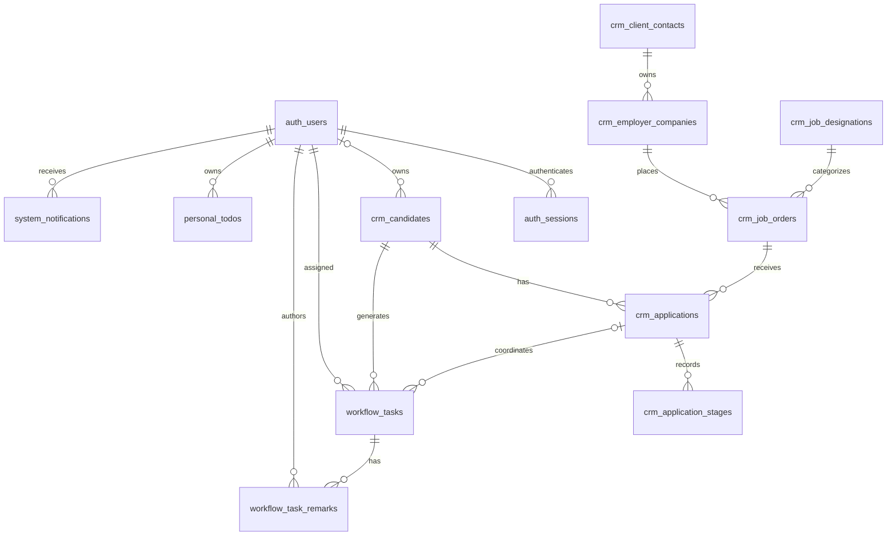

# Recruitment CRM database design

This document is the table dictionary and maintenance guide for the database behind the [PRD architecture](architecture.md). It describes the physical names introduced by revision `0006_domain_table_names` and separates that naming change from the business-model work still needed in the [implementation phases](implementation-phases.md). Check each database's Alembic revision before using the new names; the dated rollout verification below applies to the configured Care India database.

**Rollout status, 20 October 2026:** Care India's live PostgreSQL 18.6 database is now at `0006_domain_table_names`. After coordinating the old backend shutdown, the database backup was restored into an isolated PostgreSQL 18 container and all 20 business-table counts and fingerprints matched. The live migration verified unchanged contents and table object identities before committing; its revision and new names were then checked through a separate connection. The normal local API and frontend proxy report healthy PostgreSQL and Redis. Backup and verification artifacts remain outside Git. The existing attachment was not present in local upload storage: retain the old application's storage until its file is located and made available through the new deployment. Production HTTP readiness and upload availability still need deployment acceptance checks. This naming rollout does not complete the remaining CRM model or business-rule phases.

The backend uses SQLAlchemy 2, psycopg 3 and Alembic. Local Docker Compose specifies PostgreSQL 16; the configured Dokploy database reports PostgreSQL 18.6. These are separate environments, not a claim that the live server runs the Compose image.

## Ownership and source of truth

- [SQLAlchemy models](../backend/app/db/models.py) define 20 application tables. Alembic maintains a separate `alembic_version` metadata table, so pgAdmin normally shows 21 tables.
- [Database sessions](../backend/app/db/session.py) own connection pooling and request session lifecycle.
- [Alembic revisions](../backend/alembic/versions/) define schema history. Revisions `0001`–`0005` remain unchanged; `0006_domain_table_names` supplies the reversible naming and description update.
- [API schemas](../backend/app/api/schemas.py) define HTTP response shapes, not database tables.
- Frontend types and cached state are consumers of the API. Screens never connect directly to PostgreSQL or allocate durable record IDs.

Use one CRM database. A candidate is a reusable person record, an application is the candidate's recruitment history for one order, and a task is the action currently due. A personal to-do is independent of the recruitment task lifecycle. These distinctions come from PRD pp. 4–7 and 11–12.

Prefixes group existing tables by responsibility within the `public` schema: `auth_` for identity, `crm_` for recruitment records, `workflow_` for assigned work, `email_` for mailbox records, `document_` for uploaded documents, `personal_` for private reminders and `system_` for notification/audit records. `ingestion_failures` keeps its already descriptive name. This does not introduce duplicate tables, separate databases, extra schemas or replacement accounts.

## Table dictionary

The old-name column identifies tables through revision `0005_candidate_ocr_data`. The new-name column identifies the same records after `0006_domain_table_names`; primary keys, column names, foreign-key relationships and existing records remain intact.

| Group | Old name | Name after `0006` | Purpose | Key relationships |
| --- | --- | --- | --- | --- |
| Identity | `users` | `auth_users` | Accounts, Argon2id password hashes, assigned roles, activation and assignment eligibility | Referenced by sessions, candidate/task owners, authors and recipients |
| Identity | `sessions` | `auth_sessions` | Revocable sign-in sessions and expiry | `user_id` → `auth_users.id` |
| CRM | `clients` | `crm_client_contacts` | Existing client/contact records | Parent of `crm_employer_companies` |
| CRM | `companies` | `crm_employer_companies` | Employer company details and location | `client_id` → `crm_client_contacts.id`; parent of job orders |
| CRM | `designations` | `crm_job_designations` | Job titles, categories and requirements | Referenced by `crm_job_orders.designation_id` |
| CRM | `orders` | `crm_job_orders` | Recruitment openings, employer, designation and order status | `company_id` → `crm_employer_companies.id`; `designation_id` → `crm_job_designations.id` |
| CRM | `candidates` | `crm_candidates` | Candidate profile, owner, source, call outcome, resume text and raw OCR evidence | Optional `owner_id` → `auth_users.id`; parent of applications and tasks |
| CRM | `applications` | `crm_applications` | Candidate-to-order mapping, current stage/draft and closure history | `candidate_id` → `crm_candidates.id`; `order_id` → `crm_job_orders.id`; optional draft author → `auth_users.id` |
| CRM | `application_stages` | `crm_application_stages` | Stage attempts, outcomes, submitted fields and completion history | `application_id` → `crm_applications.id`; optional `completed_by` → `auth_users.id` |
| Workflow | `tasks` | `workflow_tasks` | System-created recruitment work, owner and completion/escalation state | `candidate_id` → `crm_candidates.id`; optional `application_id` → `crm_applications.id`; `owner_id` → `auth_users.id` |
| Workflow | `remarks` | `workflow_task_remarks` | Timestamped task updates | `task_id` → `workflow_tasks.id`; `author_id` → `auth_users.id` |
| Workflow | `assignment_pointer` | `workflow_assignment_cursor` | Single persisted position for staff round-robin assignment | Optional `last_user_id` → `auth_users.id`; singleton row `id = 1` |
| Personal | `todo_items` | `personal_todos` | Private reminders with manual completion | `owner_id` → `auth_users.id`; optional UI link is a string, not a record foreign key |
| Email | `mail_accounts` | `email_accounts` | Mailbox/provider configuration and synchronization metadata | Parent of `email_messages`; provider integration remains planned |
| Email | `mail_messages` | `email_messages` | Mailbox messages and optional candidate association | `account_id` → `email_accounts.id`; optional `candidate_id` → `crm_candidates.id` |
| Email | `mail_attachments` | `email_attachments` | Source-message file metadata and content hashes | `message_id` → `email_messages.id` |
| Intake | `ingestion_failures` | `ingestion_failures` (unchanged) | Failed intake attempts, reason and resolution state | Existing source/file descriptors; no message/job foreign key yet |
| Documents | `attachments` | `document_attachments` | Versioned document metadata, owner/slot and storage key | Optional `uploaded_by` → `auth_users.id`; record owner uses `entity_type` + `entity_id` |
| System | `notifications` | `system_notifications` | Recipient-specific bell messages and read state | `user_id` → `auth_users.id`; optional UI link |
| System | `audit_log` | `system_audit_log` | Recorded actions, actor, time and affected entity | Optional `actor_id` → `auth_users.id`; affected record uses `entity_type` + `entity_id` |

`alembic_version` is required migration metadata, not a CRM record collection. Its name is unchanged. Empty email/intake/notification tables remain schema groundwork for the PRD; an empty table does not prove a feature works or make that table safe to delete. Future additions must be justified by the owning phase rather than created speculatively.

Physical table names are separate from HTTP routes, frontend collection keys and entity-type values. `/api/candidates`, bootstrap keys such as `users` and `applications`, model classes such as `User`, and document/audit owner types such as `candidate` remain unchanged. Backend authentication, authorization, assignment, workflow transitions and validation determine how stored data is used; naming tables does not implement those rules.

## Core relationships after `0006`



The `crm_client_contacts → crm_employer_companies → crm_job_orders` chain preserves the **existing implementation**, where a client is a contact who owns companies. The PRD calls the employer itself a client (p. 3). Phase 2 must reconcile the UI and model with that requirement while retaining existing records and placement history. Revision `0006` clarifies existing table responsibilities; it does not merge contacts with employers, normalize the whole model or complete that reconciliation.

`document_attachments` associates records through `entity_type` and `entity_id`, rather than a foreign key to each possible owner table. The file service must validate record existence and access. File bytes remain in storage, separate from metadata. Preserve old file versions and avoid orphan cleanup that deletes documents still referenced by historical stages.

## Inspect accounts and records in pgAdmin

After applying `0006` with the matching backend version, refresh **Care India Dokploy → Databases → care_india → Schemas → public → Tables**. Start with `auth_users` for accounts and `auth_sessions` for sign-ins. The `auth_` names appear together near the top; `alembic_version` is the migration marker.

For an account overview without displaying password hashes, open the database's Query Tool and run:

```sql
SELECT id, name, email, role, active, receives_auto_assign, on_leave,
       (password_hash IS NOT NULL AND password_hash <> '') AS password_set
FROM public.auth_users
ORDER BY role, email;
```

The assigned role and activation are saved values. Passwords are Argon2id hashes, not recoverable plaintext. Use the account CLI for provisioning/reset instead of typing plaintext into `password_hash`. Startup and login do not create default accounts or restore deleted accounts.

To check active sessions without displaying their bearer-token IDs:

```sql
SELECT u.email, count(s.id) AS active_sessions
FROM public.auth_users AS u
LEFT JOIN public.auth_sessions AS s
  ON s.user_id = u.id AND s.expires_at > CURRENT_TIMESTAMP
GROUP BY u.id, u.email
ORDER BY u.email;
```

Login creates a session, logout removes the current session, and a password reset revokes that account's sessions. Refresh or rerun the query to see committed changes; pgAdmin does not automatically stream every application write.

For candidate records, right-click `crm_candidates` → **View/Edit Data → First 100 Rows**. Use the dictionary to locate other business tables. Table/column descriptions supplied by the migration are available through their pgAdmin properties. If old names still appear after refresh, check `SELECT version_num FROM public.alembic_version;` before assuming the naming migration ran.

## Existing constraints and required guarantees

The models/migrations already include unique user email and candidate/order reference fields; a partial unique index allowing only one active application per candidate; unique stage attempt numbers; unique file versions per owner/slot; a singleton assignment pointer; and stage range checks. Open-task and candidate-search indexes also exist.

These constraints are useful safeguards, but do not complete the business rules:

1. **References:** replace `count + 1` allocation with a sequence or another atomic allocator. Deletions and concurrent requests must not reuse visible references.
2. **Application changes:** check the expected version inside the SQL update or hold the application row lock through validation and commit. A separate Python version comparison is not sufficient.
3. **Mapping:** keep the one-active-application constraint and translate conflicts into a meaningful response. Verify order status and candidate eligibility inside the command.
4. **Assignment:** candidate ownership and initial task creation belong to one successful transaction. Reassignment moves open tasks without changing their due time. Startup initializes the singleton cursor using `INSERT ... ON CONFLICT DO NOTHING`, preserving an existing position and avoiding concurrent duplicate inserts. Account provisioning is separate.
5. **Stage transitions:** stage history, task completion/cancellation, next task, candidate deployment, order counts and audit must commit together.
6. **Files:** allocate versions atomically. Handle failed storage/database writes with recoverable pending state or cleanup; a stored filename alone does not prove a stage document exists.
7. **Identity matches:** implement the PRD's normalized phone OR email OR passport duplicate policy. A blind unique constraint is not a substitute for merge/review rules, especially where identity fields point at different candidates.
8. **Search:** the existing `resume_tsv` GIN index is not enough; the application does not yet maintain the indexed value. Phase 2 must populate and refresh the search vector when accepted resume text changes, backfill existing rows, and verify that search returns those records.
9. **Historical ownership:** record the owner at candidate assignment/reassignment, stage outcome and task/escalation events during Phases 2–4. Phase 7 reports query those events; joining only to today's candidate owner would incorrectly move past performance between staff.

Keep transactions short. Slow OCR, mail provider calls and storage transfers must not hold application/task/assignment row locks. Add indexes for actual joins and filters, including ownership, order/application links and pending work; use representative query plans before introducing extra indexes or partitioning.

## OCR and document persistence

Python/FastAPI remains the backend. The existing OCR integration is separated into:

- [OCR API adapter](../backend/app/api/routers/ocr.py): authenticated file input and HTTP errors.
- [Provider client](../backend/app/integrations/ocr/client.py): submits and polls Veriis jobs.
- [Field mapping](../backend/app/integrations/ocr/mapping.py): converts provider output into candidate form fields and warnings.
- Candidate creation: stores reviewed fields plus `crm_candidates.ocr_data`; resume text supports searching and profile display.
- File endpoints: persist document metadata and versions while storing bytes under the configured storage location.

For manual entry, extraction prefills the form; saving the candidate commits the reviewed values. `ocr_data` is source evidence, not permission to overwrite user corrections. The existing raw response is deferred from the bootstrap query and fetched separately for the profile.

**Incomplete OCR identity decision:** the current database and candidate input schema require both name and phone, while PRD p. 7 requires incomplete extraction to survive as Needs review. In Phase 2, introduce an explicit review state and permit missing identity fields only for those provisional records; retain required fields in the manual-entry contract. Backfill the review state from existing data and validate the missing fields before clearing their review reasons. Phase 5 intake uses this contract to save the original document, assign the review candidate and create its task without invented names or phone numbers. Staff corrections update the same record during the first-call review. This is a planned schema/API change, not current behavior.

Phase 5 will reuse these components behind a durable ingestion service. Persist source identity, file hash, processing status, attempts, errors and provenance before acknowledging intake. A worker performs OCR outside the request, resolves duplicates, assigns only new candidates and creates tasks once. Provider adapters should return an internal extraction result so replacing an OCR provider does not require rewriting candidate screens or database workflows.

The [email automation reference review](reference-architecture-review.md) adds a concrete persistence boundary: source receipts are unique per provider/account/message/attachment; OCR executions add extraction mode and retain provider job IDs, attempt history and stable submission keys. File hashes and person identity matching are separate from delivery deduplication. Commit pending work/outbox before dispatch, and make partial-attachment retries recoverable without reassigning candidates or duplicating tasks. Use PostgreSQL migrations for these concepts rather than importing the references' MongoDB collections or startup repairs.

The backend calls an external OCR provider today; it does not contain a self-hosted OCR model. Worker infrastructure and an object-storage adapter are planned, not installed by this reorganization.

## Planned schema work by phase

| Phase | Database work to design and migrate | Completion evidence |
| --- | --- | --- |
| 1 | Safe provisioning, reference allocation, atomic versioning, complete audit references and required constraints | Restart/role/concurrency tests against PostgreSQL |
| 2 | Employer reconciliation, normalized identities, incomplete-identity review state, merge/provenance and assignment history, maintained/backfilled resume search | Existing rows preserved; incomplete OCR, duplicate/merge, search and assignment tests |
| 3 | Repeat medical attempts, reopening history, event-time stage ownership and downstream state rules | All stage transitions and negative/remap/reopen branches tested |
| 4 | Durable jobs/outbox, task due/reset and owner history, escalation events, missed-update records and deduplicated notifications | Controlled-clock and worker retry/restart tests |
| 5 | Provider receipts/checkpoints, ingestion attempts, encrypted credential storage and storage-object references | Provider replay and recovery tests without duplicate candidates/tasks |
| 6 | Session revocation/account changes and private to-do reminder delivery | Deactivation and recipient/owner isolation tests |
| 7 | Scoped reports over the history captured in Phases 2–4, with indexes justified by actual queries | Independently checked filtered totals and exports |

The exact new table/column names are decided in each implementation phase. The above is a migration plan, not a second schema to apply on top of the current models manually.

## Migration and maintenance rules

Keep the revision chain `0001_initial → 0002_advance_currency → 0003_attachments → 0004_companies → 0005_candidate_ocr_data → 0006_domain_table_names`. The first five revisions remain unchanged. Add future revisions rather than rewriting applied history.

Revision `0006_domain_table_names` renames 19 tables and 30 indexes, describes all 20 application tables and adds five identity-column descriptions. `ingestion_failures` and `alembic_version` retain their names. Existing constraint names, their backing indexes and the descriptive one-active-application index remain unchanged; an earlier label does not change what a constraint enforces. The revision preserves records, IDs, password hashes, account roles/status, session rows and relationships. Its downgrade restores the previous table/index names and removes the descriptions introduced by this revision. It creates no default accounts and requires no account recreation. PostgreSQL supports table renaming through [`ALTER TABLE ... RENAME TO`](https://www.postgresql.org/docs/18/sql-altertable.html) and stores object descriptions using [`COMMENT`](https://www.postgresql.org/docs/18/sql-comment.html).

Coordinate the migration with the API release: old code queries the old physical names and new code queries the new names. Stop API writers, take a database backup, apply the reviewed migration once, then start the matching API version and verify readiness, revision and representative reads. Refresh saved pgAdmin queries and any external SQL consumers. Do not run old and new backend mappings simultaneously against one renamed database. For rollback, stop the new API, downgrade to `0005_candidate_ocr_data`, then start the matching earlier backend; rehearse this on a disposable PostgreSQL database first. The table-rename step requires database locks, so use a release window rather than promising zero downtime.

For each schema change, review the generated SQL, test from an empty database and the previous revision, check existing records, and document any data backfill or recovery step. Keep stable primary keys during employer/identity reconciliation. Avoid deleting deployed placement history to simplify a screen.

The current Docker entrypoint applies migrations on boot. For later deployments with several API/worker instances, use one controlled migration step before starting the compatible application version. Database and file backups must be restored together and checked against attachment references.

Before phase integration tests, use a dedicated local/test PostgreSQL database, configure its connection, apply revisions through `0006_domain_table_names` and verify the revision. Establish test accounts explicitly using the CLI in the [README](../README.md). The earlier 20 October account-persistence correction required no schema change; the subsequent table-naming change does require `0006` and a coordinated backend restart. Live application of this revision must be verified separately. Remaining identity/access/concurrency policies stay in Phase 1, and employer reconciliation stays in Phase 2.
