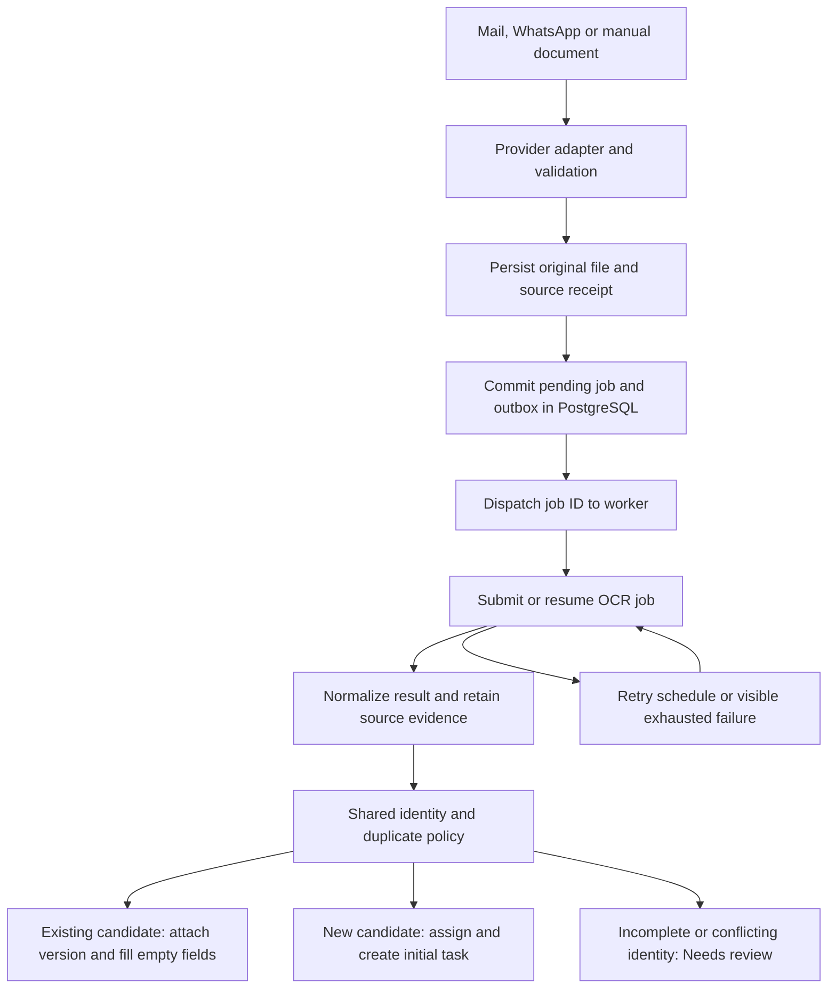

# Email automation reference review

Reviewed on 19 October 2026 at the user's request. This is a source-level comparison of `M:\email-automation-main`, `M:\gmail automation`, and the current recruitment CRM. The references were read without running their applications, jobs, tests, database operations or provider calls. Secret files and stored candidate/mailbox data were not inspected. Findings describe connected source paths, not verified production behavior.

The [12-page recruitment PRD](requirements/recruitment-crm-developer-specification.pdf) remains the target contract. The references help explain intake and operational patterns; they do not replace the PRD's roles, assignment, eleven stages or reporting rules. Implementation changes remain scheduled in the [phase plan](implementation-phases.md).

## What the reference projects contain

| Area | `email-automation-main` | `gmail automation` |
| --- | --- | --- |
| Application shape | Python/FastAPI, MongoDB, local/GridFS files, Next.js frontend | Expanded Python/FastAPI and MongoDB application, Next.js frontend, Celery/Redis and substantial operational modules |
| Mounted UI | Dashboard, candidate directory/detail/edit, automation flow view and manual Gmail sync | Overview, candidates, candidate entry/profile, assigned candidates, staff, job orders, sourcing, B2B enquiries, data management, users, settings, attendance and payroll |
| Mail intake | Gmail OAuth, message/attachment retrieval, synchronous parsing and Celery polling | Gmail plus multiple SMTP/IMAP accounts, connection reuse, message ledger and attachment-level OCR recovery |
| Extraction | Veris through a bundled SDK; local extraction and Anthropic fallback | OCR gateway, bounded requests, persisted provider job IDs, resume/identity processing and recovery |
| Candidate handling | Candidate save, update, verify and resume retrieval | Manual upload, WhatsApp intake, identity resolution, review/evaluation, assignment, matching and submission |
| Missing target UI | No role/login UI, inbox/reply/account management or eleven-stage application flow | No connected unified email inbox/reply composer, OAuth account-connection UI or OCR failure/retry console found; recruitment lifecycle differs from the PRD |

The earlier reference's `requirements.txt` does not install the bundled OCR SDK used by `app/ai/resume_parser.py`; its README describes a separate installation. The newer project's manifests include that local SDK. In this CRM, the current `veriis` dependency is declared in `backend/requirements.txt` and installed in the isolated backend environment. Copying a reference file without its declared dependencies would recreate that gap.

The larger reference has useful behavior but broad central files: approximately 5,000 lines in `app/api/routes.py`, 1,200 in `app/ingestion/pipeline.py`, and frontend orchestration concentrated in `src/app/page.tsx` and `src/lib/api.ts`. Retain this CRM's feature folders and backend boundaries instead of reproducing that concentration.

## Patterns adopted into the target design

Paths in this table are relative to `M:\gmail automation` unless marked otherwise. Adoption means architecture and acceptance criteria; these future services have not been copied or implemented in Phase 0.

| Pattern and source evidence | Recruitment CRM decision | Phase |
| --- | --- | --- |
| Mail adapters and connection cleanup: `app/email_client/factory.py`, `smtp_imap_client.py` | Put Gmail, Microsoft and IMAP/SMTP transport under `backend/app/integrations/mail/`; use per-account configuration and normalized message/attachment contracts | 5 |
| Message ledger: `app/db/ledger.py`; per-attachment/mode state: `app/db/ingestion_state.py` | Store source receipts separately from OCR jobs, candidate identity and applications; enforce receipt/job uniqueness in PostgreSQL | 4 foundation, 5 intake |
| Submitted-job recovery: `app/extraction/jobs.py`, `app/tasks/reconciler.py` | Retain the provider job ID, status, attempt count and next retry time; poll an existing job before submitting another | 4–5 |
| OCR response/normalization: `app/ai/resume_parser.py`, `app/extraction/ocr_gateway.py` | Keep Python provider calls behind the current `integrations/ocr/` boundary; return a normalized extraction result and preserve original output and human corrections | 2, 5 |
| Intake services: `app/services/candidate_intake.py`, `candidate_upload_intake.py`, `identity_intake.py` | Manual, email and WhatsApp entry points invoke one canonical candidate/identity/assignment service; retain original files and Needs review records | 2, 5 |
| Storage interface: both references' `app/storage/base.py` and `factory.py` | Preserve local development storage behind an interface; add an S3-compatible adapter with immutable versions and metadata in PostgreSQL | 5 |
| Recipient notification persistence: `app/db/notifications.py` | Persist the notification and recipient/read state before optional delivery; bounded bell polling is sufficient initially | 4 |
| Candidate list/detail separation: `frontend/src/lib/api.ts`, `src/app/page.tsx` | Replace whole-database bootstrap reads incrementally with projected, paginated lists and separate detail queries in each feature | 2 onward |
| Upload/review UI: `frontend/src/screens/CandidateUploadScreen.tsx`, candidate profile components | Keep upload progress, retryable errors, source documents and extraction evidence visible beside editable fields | 2, 5 |
| Stored contract checks: `b2b-enquiry-contract.md` | Verify saved fields, document references and provenance, not merely HTTP success; provider fields must not silently disappear | 2, 5 |

## Target intake and recovery contract

The following identifiers answer different questions and must remain separate:

1. **Source receipt:** which provider/account/message/attachment delivered this file? Use a uniqueness constraint over the stable provider identity. For IMAP include folder and UIDVALIDITY with the UID; an unread flag is not an intake checkpoint. Reading a message manually must not permanently remove it from ingestion.
2. **File hash:** have these bytes already been processed? Reuse valid extraction evidence where appropriate, but retain each source receipt and candidate/document link. A matching hash does not prove that an entire email or every attachment succeeded.
3. **OCR execution:** which extraction mode/job processed this attachment? Resume and passport work can succeed or fail independently. Save the provider job ID, attempt history and stable submission key. Recover an uncertain submission through that key where supported; do not blindly create another paid job after a timeout.
4. **Person identity:** does normalized phone, email or passport match an existing candidate? Apply one PRD policy to every channel. Conflicting matches enter review. Delivery retries must not advance round-robin again or create another initial task.
5. **Application:** which order and recruitment attempt does this person belong to? Intake updates candidate evidence; it must not overwrite an application's stage history, owner decisions or deployment results.

Save the original file before acknowledging durable intake. If the subsequent database write fails, retain a recoverable pending object or clean it up through an explicit orphan policy. Commit the receipt/job/outbox before dispatch; after a broker outage the dispatcher can replay committed work. Worker transitions use conditional writes and uniqueness constraints, not only process-local locks. OCR calls run outside database transactions.

The reference's `app/ingestion/job_recorder.py` records state after submission and suppresses ledger-write failures. Its email sender sends before recording completion. These mechanisms aid recovery but do not guarantee exactly-once processing or delivery. The target must make persistence failures visible. Outbound mail should record pending/sent/failed/unknown attempts and reconcile uncertain delivery before automatic retries; an SMTP timeout must not be treated as proof that nothing was sent.

Use one scheduler process for mailbox polling, retry recovery, overdue scans and daily checks. API requests may enqueue work, but the API must not silently become the scheduler or run full ingestion when a worker is unavailable. Expose worker/scheduler/provider health to Admin and retain queued work during an outage. This deliberately improves on the reference's API-owned poller and inline fallback.

## PRD rules that take precedence over the references

| Topic | Observed reference difference | Target decision |
| --- | --- | --- |
| Database | MongoDB collections and GridFS, with some startup repair/index work | Keep PostgreSQL/SQLAlchemy/Alembic; reviewed migrations and explicit maintenance commands |
| Frontend | Next.js/React 19 | Keep the existing Vite/React 18 workspace and feature boundaries; adapt interaction patterns rather than framework files |
| Roles | Includes Finance Manager and granular reference-specific page grants | Admin, Manager and Staff as defined by the PRD |
| Candidate visibility | Staff candidate reads restricted to assigned records | All Data Bank candidates visible; Staff mutations restricted to owned work; reports and private to-dos retain their own scope |
| Assignment | Country/desk eligibility and rotation, with separate workload rebalance | Strict global rotation over active, available, auto-assign-enabled Staff; locked cursor; no workload/desk exceptions |
| Duplicate handling | Policies vary between email, passport identity and WhatsApp submission paths | One normalized phone OR email OR passport policy, manual merge/cancel and automatic empty-field-only updates without owner changes |
| Lifecycle | Evaluation/recruitment/interview/offer fields mainly on candidate | Separate application per order with all eleven stages, four exits, repeated medical, reopening and retained history |
| Order progress | Reference UI derives fulfilled count from submitted IDs | Count deployments after stage 11; submissions/mappings do not fill an order |
| SLA | Candidate-open/evaluation timers; actual backend defaults include 48h Manager, 72h designated Admin and hourly scans | Every event task has 48 continuous hours; scan every 15 minutes; Admin and Managers together; 24h repeat reminders and daily owner remarks |
| Audit | Some frontend logs live in localStorage | Backend-persisted immutable audit events with actor/time/entity references |
| Reporting | Overview/workload/review/HR emphasis | Six PRD reports, historical ownership, shared filters and scoped Excel/PDF exports |

Reference SLA comments/UI fallbacks disagree with its backend defaults. The comparison uses actual source behavior and configuration, not those comments. Similarly, the flow visualizer in the earlier project animates stages in the browser and is not proof of actual worker telemetry.

Outside this PRD: attendance, payroll, reimbursements, branch approval chains, Finance Manager, Sourcing Hub/B2B conversion, Aadhaar extraction, nationality rejection, destination-specific CV requirements and WhatsApp group intake. These are not added to this CRM without a separate requirement.

## Frontend completion and verification lessons

The larger reference has no mounted unified email inbox, reply composer or ingestion-failure review UI. Its `EmailRulesScreen`, `ActivityLogsScreen` and `CandidateLogsScreen` files are not mounted, and the manual-sync callback passed to `TopBar` is not consumed there. Therefore those files are references for future work, not evidence that the target Inbox requirements are already satisfied.

Complete the target `features/inbox` as a coherent vertical slice: per-account connections, message lists/details, attachment preview and candidate link, originating-account replies, auto-ingest toggles, manual intake, and a failure/review/retry view. Keep candidate correction under `features/candidates`, workflow under `features/workflow`, and server-fed task/notification state under their own modules. A visible button must have a validated API action, persisted result and observable failure state.

Relevant reference test sources include `test_pipeline_redelivery.py`, `test_duplicate_candidate_ingestion.py`, `test_gmail_concurrency.py`, `test_message_id_accounts.py`, `test_imap_peek.py`, `test_ocr_resilience.py`, `test_candidate_creation_dedup.py`, `test_manual_assignment_protection.py` and `test_notifications.py`. Adapt their scenarios to this PRD and PostgreSQL; their presence or historical reported results are not proof that this CRM passes them.

Add acceptance cases in the owning phases for duplicate deliveries, one failed attachment among successful siblings, OCR timeout/restart, same message ID in different accounts, IMAP checkpoint changes, broker outage after DB commit, repeated worker execution, partial identity review, preserving recruiter corrections and ownership, and recipient-scoped notifications. No live database or provider validation was performed as part of this reference review.
